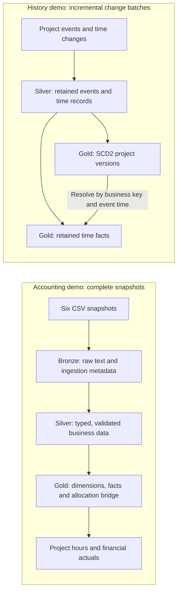
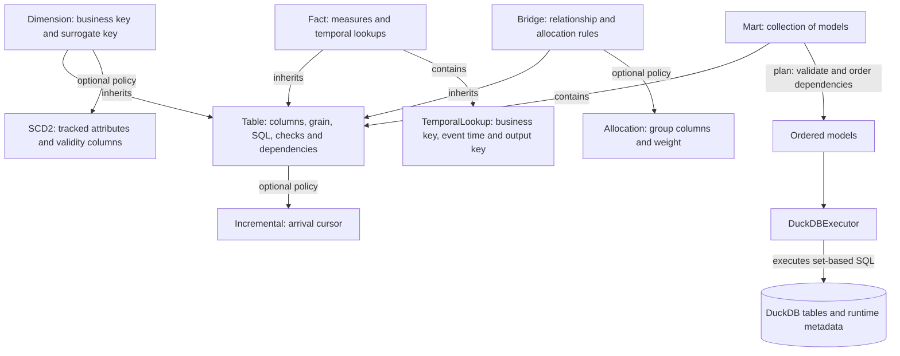
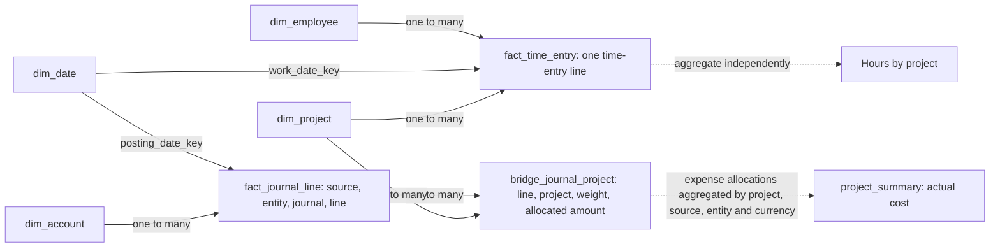
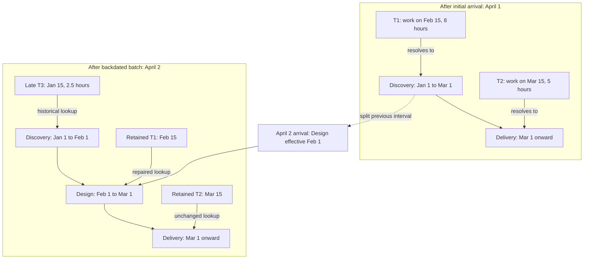
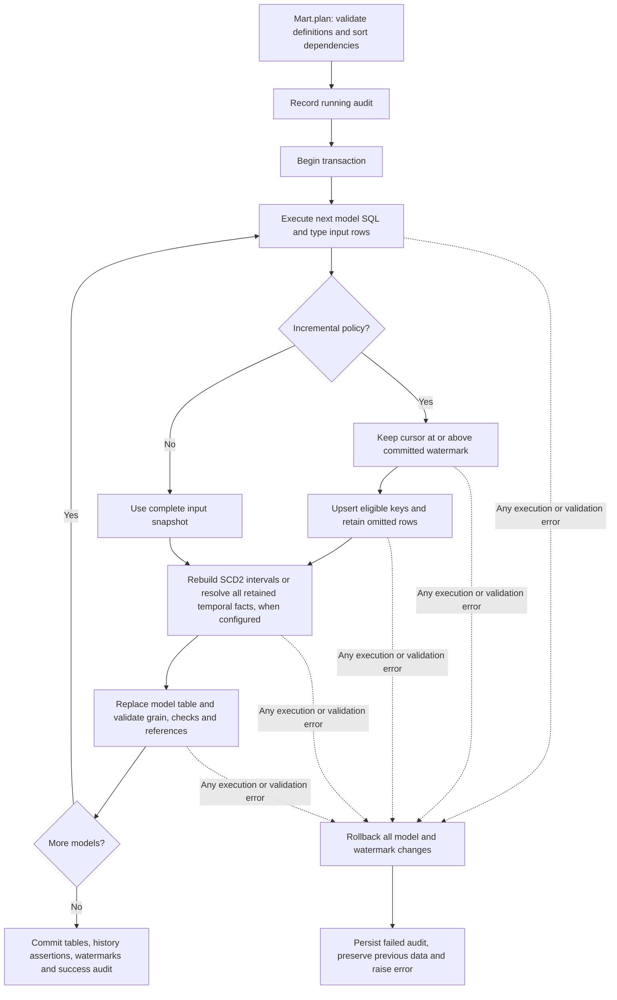

# Fabric Data Stellar

A Python library for metadata-driven analytics engineering, with a runnable
Project Management and Accounting mart. It runs locally on DuckDB; Fabric is a
future execution target, not a current dependency.

## Quick start (PowerShell)

Python 3.11 or newer and [uv](https://docs.astral.sh/uv/) are required.
Run these commands from the project root:

```powershell
uv sync --extra dev
uv run data-stellar demo
uv run data-stellar history-demo
uv run pytest
uv run ruff check .
uv run mypy
```

The demo creates `output\project_accounting.duckdb`. Run it again to rebuild
the mart without duplicating business rows. Alternatively, select explicit paths:

```powershell
uv run data-stellar demo --database output\demo.duckdb --source-dir examples\project_accounting
```

Expected results:

| Project | Hours | Actual expense (USD, demo_erp / LEG1) |
|---|---:|---:|
| P100 | 12.50 | 800.00 |
| P200 | 5.00 | 400.00 |

All example records are synthetic.

## Architecture

The two demos use separate databases and loading strategies:



Data Vault and Fabric execution are future extensions, not stages used by either demo.

- **Bronze:** source fields are retained as text, with batch ID, load timestamp,
  source file and raw row number. Raw row numbers identify rows within the current
  snapshot, not stable business identities.
- **Silver:** explicit typing, declared grains, source relationships, nonnegative
  hours, currency-code format, and journal balancing per source/entity/journal/currency.
  Malformed values fail the run rather than being dropped or silently rounded.
- **Gold:** Project, Employee, Account and Date dimensions; Time Entry and Journal
  Line facts; a Journal-Project allocation bridge; allocation reconciliation and
  project cost summaries.
- **Runtime audit:** `_stellar.runs` records run ID, source batch, timestamps,
  status and error. Business tables and a success status commit together. Failed
  executions roll back all model changes, preserve previously published data and
  persist the failure status.

The calendar spans the inclusive minimum/maximum dates in the current snapshot.
MD5-derived dimension keys are deterministic for the example's single-column
business identities; both surrogate and business-key uniqueness are validated.
They are not security hashes or a general multi-source identity-resolution scheme.

## Modeling API

[models.py](src/data_stellar/models.py) contains frozen typed declarations:

| Declaration | Contract |
|---|---|
| `Table` | Schema, explicit grain, SQL, dependencies, references and quality predicates |
| `Dimension` | Surrogate-key grain, business key and optional SCD2 history |
| `Fact` | Dimension references, numeric measures and optional temporal lookups |
| `Bridge` | At least two references, optional exact decimal allocation weights |
| `Mart` | Registry validation and topological dependency planning |
| `Incremental` | Non-null timestamp arrival cursor and grain-based upserts |
| `SCD2` | Tracked attributes and effective-date interval columns |
| `TemporalLookup` | Natural-key and business-time resolution to a historical surrogate |

`Mart.plan()` rejects duplicate models, unknown dependencies/columns, invalid
reference targets, and dependency cycles before execution.
`DuckDBExecutor.run()` materializes models in dependency order and validates each
before proceeding. Query output columns must match declared input columns exactly;
SCD2 surrogates/end/current flags and temporal surrogate outputs are runtime-generated
and must not appear in source SQL.
All declared grains are non-null and unique. Type-1 business keys are unique;
SCD2 business keys repeat across non-overlapping versions and cannot be ordinary
foreign-key targets. Optional composite references may be
entirely null; partially null references fail.

Example:

```python
import duckdb

from data_stellar import Column, DataType, Dimension, Mart
from data_stellar.duckdb import DuckDBExecutor

project = Dimension(
    name="gold.dim_project",
    columns=(
        Column("project_key", DataType.TEXT),
        Column("project_id", DataType.TEXT),
    ),
    grain=("project_key",),
    business_key=("project_id",),
    surrogate_key="project_key",
    query="SELECT md5('P100') AS project_key, 'P100' AS project_id",
)

with duckdb.connect(":memory:") as connection:
    result = DuckDBExecutor(connection).run(Mart("example", (project,)))
    print(result.row_counts)
```

Models represent datasets, not individual rows. Transformations are set-based SQL.
SQL and check predicates are trusted developer-authored code, not sandboxed input.
An example extension lives in [example.py](src/data_stellar/example.py).

### How the Python objects work together

The solid arrows below describe inheritance, composition, or execution, not data flow.



### Accounting star schema and bridge

Arrows run from a referenced dimension or fact to the rows that reference it.
Each journal line can reach multiple projects through allocation rows; time facts
reference projects directly. Date is a shared dimension with different date roles.



Solid arrows are logical key relationships; dashed arrows are analytical aggregation.
The cost query also joins Journal, Account and Project. It never joins Time to Journal.

## Historical and incremental loading

The separate [history example](src/data_stellar/history_example.py) runs initial and
backdated change batches without altering the full-refresh accounting example:

```powershell
uv run data-stellar history-demo
```

It persists `output\project_history.duckdb`. In the first batch T1 maps to
**Discovery** and T2 to **Delivery**. The second batch inserts a Design version
effective February 1: the already-stored T1 is repaired to **Design**, T2 remains
**Delivery**, and a late-arriving January fact T3 resolves to **Discovery**.
Final hours are 8.00, 5.00 and 2.50 respectively. Replaying both batches against
an existing database retains the final state; it does not rewind to the initial state.

### Backdated changes and temporal fact repair

Business-effective dates and arrival cursors are different clocks. The February
change below arrives on April 2, after the initial batch arrived on April 1.
Intervals include their start and exclude their end.



The arrows between versions show chronological order. No fact is discarded if
history is missing: the batch fails, and it can be retried after history arrives.

### Execution, watermarks and atomic publication

Each model finishes validation before dependent models execute. All model changes
share one transaction; the failure audit is written after rollback.



### Contracts

- Opt in per table with `incremental=Incremental("updated_at")`. Source SQL may
  return a complete extract or just changed rows. Omitted rows are retained; there
  are no implicit deletes. Each eligible batch must contain at most one row per
  grain (or business key + effective timestamp for SCD2); collapse source change
  streams to their latest assertion per key before handing them to the executor.
- Cursors represent **arrival/update order**, not business effective time. They
  must be finite, non-null TIMESTAMPTZ values. New arrivals must have a cursor
  greater than or equal to that model's committed maximum. Older cursor rows are
  intentionally filtered out. Late business events require a fresh arrival cursor.
  Out-of-order arrival cursors below the watermark need an explicit replay/migration;
  no automatic lookback window or source-side extraction pushdown is implemented.
- Equal-cursor rows allow boundary replay and additional keys sharing a timestamp.
  A different payload for an existing key at the same cursor fails explicitly.
  Corrections must carry a newer cursor. Empty batches preserve the watermark.
- `Dimension(history=SCD2(("project_name",)), incremental=Incremental("updated_at"), ...)`
  declares Type-2 behavior. Define a TEXT surrogate, non-null TIMESTAMPTZ
  `valid_from`, nullable TIMESTAMPTZ `valid_to`, and non-null BOOLEAN `is_current`.
  Every other column must have one distinct role: business key, cursor or tracked
  attribute. Mixed Type-1 attributes inside an SCD2 dimension are not yet supported.
- Dimension source SQL returns business keys, tracked attributes, `valid_from`,
  and the arrival cursor. Corrections upsert by business key + `valid_from`.
  Every timestamp represents an explicit effective-date assertion; source omissions
  do not mean deletion or expiration.
- Versions use **[valid_from, valid_to)** intervals; a null end means open-ended.
  Adjacent identical tracked values coalesce, with null-safe comparisons. Original
  assertions remain in internal `_stellar.history_*` tables: a no-op assertion can
  become meaningful after a later backdated insertion. These tables retain the
  latest assertion per effective timestamp, not a bitemporal correction audit.
- Version keys hash a JSON tuple of the business key and effective epoch
  microseconds. Unchanged version starts keep their keys; corrections can remove
  coalesced versions. Key uniqueness and contiguous intervals are validated.
- A `TemporalLookup` declares the fact's natural-key columns, target dimension,
  business-time column, and generated surrogate output. Input natural keys and
  event time are retained. The fact may use DATE (interpreted as midnight UTC) or
  TIMESTAMPTZ. Use explicit timezone offsets when ingesting timestamps.
- The executor re-resolves **all retained facts in participating models** on each
  run. A backdated dimension change therefore repairs old foreign keys even when
  the incoming fact batch is empty. Include all affected facts and dependent
  summaries in the mart; models outside it are not automatically discovered.
  This is incremental ingestion with full retained-data publication, not
  partition-pruned or changed-key-only execution.
- Zero or multiple valid temporal matches fail the whole run. No inner join may
  silently discard those facts. Supply missing dimension history and retry the
  same batch; there is no unknown-member or quarantine fallback.
- Watermarks and stateful model contracts live in `_stellar.model_state`.
  Retained source assertions, published tables, watermarks and successful audit
  status commit atomically. Failure rolls back all of them and records an error.
  Stateful column/key/history/lookup changes and owner changes require an explicit
  migration; switching to full refresh or adopting a table without state is rejected.

DuckDB's Python timestamp conversion requires `pytz`, included as a runtime dependency.

## Accounting and allocation semantics

- Each journal line is identified by source system, entity, journal and line number.
- Debit and credit are nonnegative decimal amounts; signed amount is debit minus credit.
- The example accepts expense and cash account classifications only.
- Every journal line must have project allocations, including balancing cash lines.
  Unallocated lines fail explicitly; an unknown-project fallback is not invented.
- Weights have eight decimal places, lie between zero and one and sum **exactly**
  to one per journal line. Negative or over-precision values fail.
- Allocation uses the largest-remainder method on absolute integer cents, then
  restores the sign. Remaining cents go to the largest fractional remainder,
  breaking ties by project ID. Allocated amounts reconcile exactly to every line.
- This initial example assumes two-decimal currencies. It does not implement
  currency-specific minor units, exchange rates, or currency conversion.
- Costs remain separated by source, entity and currency.
- Hours and costs are reported separately: raw facts are never joined together.
  Measure aggregation metadata documents semantics; it does not generate a BI
  semantic layer or prevent arbitrary user-written SQL from mixing currencies.

## Current scope and boundaries

This is a local modeling foundation, not a production warehouse framework.

**Implemented:** typed model contracts, dependency planning, transactional
full-refresh and timestamp-cursor upsert execution, Type-1 and Type-2 dimensions,
backdated interval splitting, temporal fact repair, late arrivals, decimal allocations,
quality checks, transactional watermarks, audit records, an installed CLI, and regression tests.

**Not implemented:** source CDC connectors, deletes/tombstones, bitemporal audit,
append-only Bronze history, budget/snapshot facts, Data Vault, Fabric/Spark execution,
Power BI, automatic schema migrations, or concurrent writers.

Models without an incremental policy replace their data from complete input snapshots,
including removal of absent rows. Do not feed them partial extracts. Incremental models
retain omitted records and upsert eligible changes. Business row counts and keys are
replay-stable, but ingestion timestamps and run IDs change.
Source files must remain unchanged during a run. Use a dedicated DuckDB connection
outside any existing transaction.

Budget and periodic snapshot facts are possible next extensions. Data Vault remains
an optional later integration layer. A future Fabric adapter must implement and test
its own SQL, storage, and commit semantics; DuckDB transactions do not imply that
multi-table Delta writes can be atomic.
